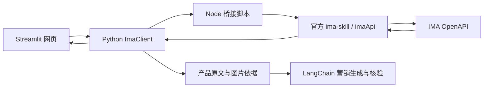

# IMA Skill 在本产品中的集成

本产品已经内置官方 IMA Skill。用户使用网页上的搜索、阅读、笔记功能，无需在自己的 Codex 中安装 Skill。

## 调用结构

`vendor/ima-skill/` 保留官方脚本、接口说明和资源。项目遵照其中的规则，将操作封装成 `ima_client.py` 中的方法。当前使用固定 Python 工作流，模型不直接执行 `SKILL.md`，也不接收 IMA 密钥。

## 三项能力如何落地

| 能力 | 产品入口 | Python 方法 | IMA 接口 |
| --- | --- | --- | --- |
| 搜索知识库 | “搜索 IMA 资料”→“搜索资料” | `ImaClient.search` | `wiki/v1/search_knowledge` |
| 读取资料 | 选择搜索结果→“读取选中资料”，或加载产品资料 | `ImaClient.read_text` | `wiki/v1/get_media_info`，笔记类型再调用 `note/v1/get_doc_content` |
| 创建笔记 | “新建 IMA 笔记”，或生成后“在 IMA 新建营销笔记” | `ImaClient.create_note` | `note/v1/import_doc` |

搜索是当前接口文档定义的关键词搜索，不承诺向量语义召回。阅读支持文本、Markdown、有文本层的 PDF，以及接口允许读取的笔记。PDF 最多提取前 25 页；扫描件 OCR、网页正文、Word/PPT 正文解析未实现。

独立搜索供查阅，不自动替换营销生成所用的产品资料。生成仍只使用用户选定产品目录的证据，避免混用相近型号。

创建笔记支持文字 Markdown，标题写为正文的一级标题。营销笔记直接复用已有 Markdown 导出，保留来源和核验状态。图片以配图说明、来源等文字记录保存；编辑器中的内嵌图片会提示改在 ima 客户端添加。创建目标是凭证所属账号的个人笔记默认位置；加入共享知识库是另一项操作，目前没有自动执行。

## 运行和部署

1. 一起分发项目代码、`requirements.txt` 和完整的 `vendor/ima-skill/`。
2. 部署环境安装 Python 依赖及 Node.js LTS。
3. 服务端设置 `IMA_OPENAPI_CLIENTID`、`IMA_OPENAPI_APIKEY`、`IMA_KB_NAME`。个人本地运行也可复用 `~/.config/ima/` 中的凭证。
4. 启动 `start.bat`，或运行 README 中的 Streamlit 启动命令。
5. 在网页连接知识库，随后使用搜索、阅读、笔记入口。

`IMA_SKILL_PATH` 默认指向 `vendor/ima-skill/ima_api.cjs`。凭证从环境变量传给官方模块，请求仅发往 `https://ima.qq.com`。正文通过 `tools/ima_bridge.cjs` 的标准输入传入，显式验证 UTF-8，避免长篇中文超过 Windows 命令行长度限制。

当前产品使用服务端同一组凭证，不是每位用户各自登录 IMA 的多租户服务。笔记属于这组凭证对应的账号。部署时不分发个人 `.env` 或凭证文件。

## 写入行为与验证

填写正文、生成营销稿、刷新普通页面都不会自动创建笔记，只有点击新建按钮才调用写入接口。成功后，在当前连接会话内禁用相同内容的重复保存；重新连接或重启会清除此记录。接口业务错误直接显示，超时不自动重试，因为服务端可能已完成创建。

离线测试模拟 IMA 响应和笔记写入，并通过真实 Node 子进程验证长篇中文的标准输入传输，不会向真实账号写入测试内容。真实笔记创建仍需在网页中使用本人账号验收。

如果以后要改为“聊天时由模型自主选择搜索、阅读、新建笔记”，可以在这些客户端方法之上再封装 LangChain 工具并加入工具调用循环。现有版本仍由页面和固定工作流调度。
