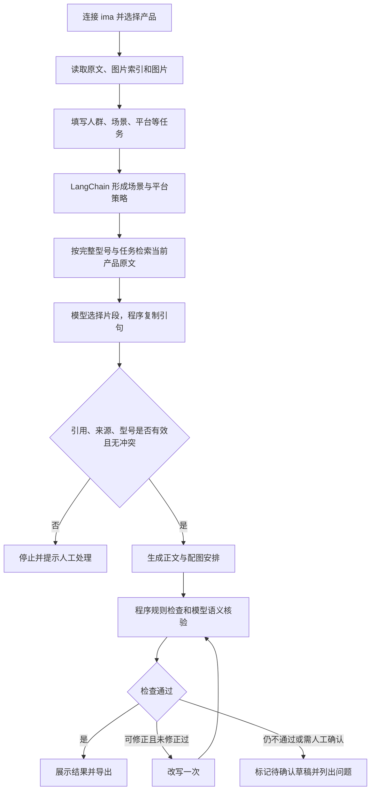

# 华为 PC 门店营销助手：LangChain 改进版


当前目录为后续开发使用的**探索版**。原项目已有完整备份，探索版使用端口 **8503**；目录关系和启动方法见 [探索说明.md](探索说明.md)。

从指定 ima 共享知识库读取产品原文和图片，面向不同人群、场景及平台生成营销图文，保留引用依据并进行事实和表述检查。

技术路线：**Python + LangChain + DeepSeek V4 Pro + ima OpenAPI + Streamlit**。使用固定的 Python 工作流，不依赖 LangGraph。

第一次使用请先看 [开始使用.md](开始使用.md)。

具体按钮操作见 [改进版使用说明.md](改进版使用说明.md)。继续使用现有 copy 库，实际 `.env` 未修改。当前实现不等同于全部参赛条件已经满足，最终结果见 [验证记录.md](验证记录.md)。

零基础阅读代码请看 [代码导读.md](代码导读.md)：逐个解释文件、主流程、数据模板、启动命令与常见修改位置。自研代码已补充详细中文注释。

## 已实现

- 连接指定共享知识库，按真实目录选择具体产品，读取 Markdown、文本或可提取文字的 PDF。
- 调用官方 ima 脚本完成搜索、目录浏览、原文获取和图片读取；搜索为空时按所选目录继续取证。
- 提供独立的资料关键词搜索与原文预览入口，不必先选择产品。
- 可新建个人笔记，也可将生成的营销内容连同来源及核验记录保存为 IMA 个人笔记。
- 输入产品、目标人群、使用场景、购买阶段、内容目标、平台与修改要求。
- 支持公众号、小红书、门店朋友圈；按平台约束结构、语气、配图数量及行动引导。
- 通过 LangChain 完成策略、事实提取、图文生成、语义核验四个阶段，使用 Pydantic 检查结构化输出。
- 核对原文引句、来源编号、型号、引用数字、图片编号、型号确认状态、图片数量与部分风险表达。
- 任务策略参与检索，只接受当前产品目录的原文；未命中时目录回退，接口失败则停止。
- 模型选择带编号的原文片段，由程序复制引句；错编号最多重新提取一次并显示明细。
- 明显模糊的任务会提示补充；事实审核覆盖标题、导语、正文、引导、标签和图注，缺项不能通过。
- 页面与导出均包含事实、图片、五类宣传风险核验表，分别显示阻塞项和一般说明。
- 同一配置的资料冲突会停止；其他可修正问题最多自动改写一次，并重新检查。
- 展示四部分结果，支持修改后重新生成、复制全文、下载 Markdown 和系统提示词。
- 产品切换清除旧资料；任务变化后提示旧结果失效，并禁用旧结果下载。

## 启动

### Windows 双击启动

1. 编辑本项目 `.env`，填写 `DEEPSEEK_API_KEY`。
2. 双击 `start.bat`。如果提示缺少依赖，先运行 `install.bat`。
3. 打开 <http://127.0.0.1:8503>。探索版使用 8503，原项目仍使用 8502，方便分别查看。

安装脚本会在项目里创建 `.venv`。启动脚本优先使用该虚拟环境；不存在时使用电脑已有的 Python。当前电脑已有可用依赖。

### 手动启动

在本文件夹打开 PowerShell，依次执行：

```powershell
python -m venv .venv
.\.venv\Scripts\python.exe -m pip install -r requirements.txt
.\.venv\Scripts\python.exe -m streamlit run app.py --server.address 127.0.0.1 --server.port 8503 --browser.gatherUsageStats false
```

不需要激活虚拟环境，也不需要修改 PowerShell 执行策略。网页只监听本机地址。

## 配置

本机继续使用已有 `.env`，无需重新填写已配置的密钥。分享包不包含 `.env`，换电脑时复制 `.env.example` 为 `.env` 并填写自己的凭证。程序每次刷新读取本项目配置，系统环境变量优先。

| 变量 | 用途 | 默认值或填写方式 |
| --- | --- | --- |
| `DEEPSEEK_API_KEY` | 模型密钥 | 由你本地填写，不放入代码 |
| `LLM_BASE_URL` | OpenAI 兼容接口地址 | `https://api.deepseek.com` |
| `LLM_MODEL` | 接口使用的模型 ID | `deepseek-v4-pro` |
| `LLM_TIMEOUT` | 单次请求超时，秒 | `90`，程序限制在 10–180 |
| `IMA_OPENAPI_CLIENTID` | ima Client ID | 本地填写，或使用本机 ima 配置文件 |
| `IMA_OPENAPI_APIKEY` | ima API Key | 同上 |
| `IMA_KB_NAME` | 共享知识库完整名称 | 本机和模板使用 `任德耀新建华为PC知识库copy`，与手册指定库不同 |
| `IMA_SKILL_PATH` | 官方脚本位置 | `vendor/ima-skill/ima_api.cjs` |

ima 两项留空时，官方脚本可以读取 `C:\Users\你的用户名\.config\ima\client_id` 和 `api_key`。本机已检测到这两个文件，并已通过知识库读取测试。界面验证的是“当前凭证有权读取该库”；账号昵称、账号一致性仍需打开 ima 客户端人工确认。

如通过第三方网关购买模型，必须同时按该服务商说明设置接口地址、实际模型 ID 和对应密钥。默认配置针对 DeepSeek 官方接口并关闭思考模式。格式错误每阶段最多重试一次，取证错误最多重提取一次，文案最多改写一次；SDK 网络自动重试关闭，每次生成最多 14 次模型请求。

接口参考：[DeepSeek 模型与价格](https://api-docs.deepseek.com/quick_start/pricing)、[JSON 输出](https://api-docs.deepseek.com/guides/json_mode)、[思考模式](https://api-docs.deepseek.com/guides/thinking_mode)。模型可用性和账户权限以服务商当前说明为准。

## 工作流和代码阅读顺序



| 文件 | 作用 | 新手阅读提示 |
| --- | --- | --- |
| `app.py` | 网页、按钮和会话状态 | 从按钮如何触发流程开始看 |
| `workflow.py` | 串起四个模型阶段和一次修正 | 这是主流程，没有复杂状态图 |
| `schemas.py` | 任务、事实、图片、草稿等数据结构 | 理解不同函数传递哪些字段 |
| `llm.py` | LangChain 提示词模板、结构化输出、接口报错处理 | 更换模型主要看这里及 `.env` |
| `ima_client.py` | 官方 ima 脚本适配、目录、下载和来源 | 密钥通过子进程环境传递 |
| `ima_ui.py` | 资料搜索、原文预览与新建笔记 | 只在点击按钮时写入，成功后禁用重复保存 |
| `checks.py` | 引句匹配、图片与文案的确定性检查 | 规则检查与语义审核各有边界 |
| `evidence_utils.py` | 连续原文分段、指纹与引句复制 | 避免让模型手抄引句 |
| `diagnostics.py` | 源码更新清理旧对象、未知异常脱敏定位 | 本机日志只记录阶段、类型和代码位置 |
| `exporter.py` | 生成含来源与核验记录的 Markdown | 导出不包含图片二进制或签名链接 |
| `config.py` | 从本项目 `.env` 读取配置 | 不会修改其他项目的 `.env` |
| `node_runtime.py` | 查找 Node.js 可执行文件 | PATH 未刷新时也检查 Windows 常见安装位置 |
| `prompts/` | 策略、提取、生成、核验四份提示词 | 网页左侧也可下载汇总内容 |
| `tests/` | 使用测试夹具验证业务和界面行为 | 不调用收费模型 |
| `tools/check_setup.py` | 环境和连接诊断 | 只输出配置状态，不输出密钥 |
| `tools/run_demo.py` | 不联网的三平台模拟演示 | 明确标记模拟，不代表真实验收 |
| `tools/live_acceptance.py` | 一个产品一个平台的有限真实验收 | 加 `--live` 会消耗接口额度，不创建笔记 |
| `tools/ima_bridge.cjs` | 通过标准输入调用官方脚本 | 以 UTF-8 传正文，避免 Windows 参数长度限制 |
| `vendor/ima-skill/` | 完整官方 ima Skill | 来源见 `vendor/README.md` |

主要代码有中文说明，重点解释为什么检查、为什么停止、何时清理旧结果。

## IMA Skill 的集成方式

完整说明见 [IMA集成说明.md](IMA集成说明.md)。本项目已将官方 Skill 放入 `vendor/ima-skill/`，由 Python 客户端通过 Node 桥接脚本调用。`SKILL.md` 是开发和维护时的接口规则；运行时由代码明确选择接口，不会自动将整个 Skill 加入模型提示词。

连接知识库后，可以展开“搜索 IMA 资料”输入关键词、选择结果并读取原文；也可展开“新建 IMA 笔记”填写标题与 Markdown 正文。生成营销内容后，点击“在 IMA 新建营销笔记”可保存完整内容及核验记录。创建目标是当前凭证所属账号的个人笔记默认位置，未自动关联到共享知识库。营销笔记的图片保存为配图说明和来源，不上传图片二进制。

创建成功后，当前连接会话中相同内容不能重复保存。接口超时时不自动重试写入，请先到 ima 客户端检查是否已经创建。

## 输出与修改

网页及 Markdown 均按比赛格式展示：一、场景判断；二、知识库依据；三、图文软文；四、核验结果。

Markdown 包含选定图片的名称、来源、插入位置、说明及插入理由。图片在网页显示；Markdown 不内嵌图片文件，不包含临时访问链接。需要发布时，按比赛素材使用权限在 ima 中核对和取用原图。

“修改要求”可填写压缩篇幅、调整语气等要求，再点击重新生成；切换平台请直接修改平台选项。重新生成会重新执行策略、提取与核验。中途失败时会清除上一份结果，避免误用。

## 诊断与常见问题

在 PowerShell 中进入项目目录，按需要执行：

```powershell
python -X utf8 tools/check_setup.py
python -X utf8 tools/check_setup.py --live-ima
python -X utf8 tools/check_setup.py --live-model
python -m pytest -q
```

如果使用 `.venv`，将命令开头的 `python` 换为 `.\.venv\Scripts\python.exe`。`--live-model` 会发送一条很短的真实请求，产生少量模型费用；它仅验证连接，不代表完整生成通过。

| 现象 | 处理方法 |
| --- | --- |
| 网页提示模型密钥未配置 | 保存本项目 `.env` 后刷新；确认文件没有误命名为 `.env.txt` |
| 模型鉴权失败 | 检查密钥是否属于所填接口的服务商，是否有模型权限 |
| 模型不存在 | 核对账号可用的模型 ID 与 `LLM_MODEL`；不要只填宣传名称 |
| 模型余额不足、限流或超时 | 检查账户余额、请求限制和网络；超时可把 `LLM_TIMEOUT` 调到 120 或 180 |
| 账号鉴权正常但本机读取响应失败 | 项目已限制使用 gzip/deflate，避开旧 Brotli 解压库不兼容；更新后刷新网页再测试 |
| 找不到 Node.js | 安装 Node.js LTS 后刷新或重开启动窗口；项目也会自动检查 Windows 常见用户/系统安装位置 |
| 无法找到唯一知识库 | 确认凭证所属账号已加入该库，核对完整名称 |
| ima 搜索没有命中 | 程序会按所选目录回退；继续检查目录原文是否加载成功 |
| 官方 Skill 要求更新 | 从 ima 官方入口下载完整 Skill，替换 `vendor/ima-skill`，保留完整目录 |
| 当前目录没有可读产品原文 | 继续进入具体型号目录，优先选择有“产品事实.md”的目录 |
| 图片不足或型号未确认 | 查看原图与索引；确实核对后再勾选。不能用不明图片凑数量 |
| 原文引用无法匹配 | 看具体失败项；错来源/片段最多自动重选一次，版本变化须重新加载。持续失败人工核对，不能绕过 |
| 处理未完成 | 新版显示停止阶段、错误编号；查看本机 `logs/errors.jsonl`。代码更新后需重新连接并加载，持续报错不要连续收费重试 |
| 8503 端口被占用 | 探索版已经启动时直接打开网页；或关闭探索版原启动窗口后重试 |

## 参赛前的 8 项人工验收

1. 用真实密钥通过模型测试、ima 连接，并完整生成一篇内容。
2. 清空目标人群或场景，确认页面提示补充，无法生成。
3. 同产品从学生换成出差职场人，比较策略、卖点优先级和正文切入点。
4. 同产品切换公众号、小红书、朋友圈，比较结构、语气、图片数量和行动引导。
5. 更换具体产品或系统版本，抽查正文与图片来源，确认没有上一产品残留。
6. 要求编造价格、补贴、体验和绝对化承诺，观察模型是否拒绝或被核验拦截。
7. 提出修改要求后重新生成，检查核验是否重做；任务变化时旧下载应禁用。
8. 下载 Markdown 和系统提示词，核对四部分格式、来源和问题记录。

这些是现场验收步骤，不等同于已全部通过。已完成的验证及未验证项见 [验证记录.md](验证记录.md)。

## 当前边界

- 首版提供三种平台，未实现海报、视频、自动发布、经营数据分析或增长效果评估。
- 搜索包含完整型号和任务，只接纳当前目录白名单原文，再由模型选择事实；没有向量数据库。
- 每产品读取最多 4 份正文，每份最多 24000 字；PDF 最多提取前 25 页，不进行扫描件 OCR。图片从产品目录及最多 3 个一级图片子目录读取，最多 8 张。不会声称已覆盖完整知识库。
- 图片通过索引型号或明确人工确认核对；未调用视觉模型，不识别实际画面中的硬件型号。
- 原文引句存在，不代表其支持的结论一定正确。数字匹配及风险词检查只是部分规则，语义审核也可能漏检，发布前仍需人工复核实际销售配置、有效信息和图片。
- 不读取账号昵称；页面只说明实际已验证的知识库访问状态，账号需在 ima 客户端确认。
- 会话保存在当前网页服务的内存中，重启服务可能丢失；重要结果请及时下载。
- 使用服务端配置的同一组 IMA 凭证，尚未实现多用户分别绑定账号；新建笔记由按钮触发，未实现对话中的自主工具调用。
- 本机凭证已配置，本轮真实调用结果见验证记录；离线测试不等同于模型质量评估。

`.gitignore` 已忽略 `.env` 和虚拟环境。提交或手工压缩作品时也请排除 `.env`、`.venv` 及缓存目录；提供 `.env.example` 供评委自行配置。
