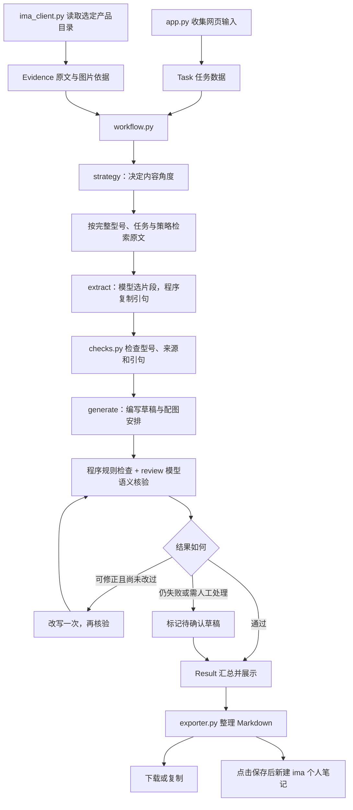

# 零基础代码导读：每个文件做什么

这份导读配合代码里的中文注释使用。你不需要一次读完全部代码，先理解“用户操作后，数据去了哪里”，再逐步学习 Python 语法即可。

项目目录：`D:\Tuozhe AI\huawei_pc_marketing_explore`。当前路线是 **Streamlit 网页 + Python 固定工作流 + LangChain + DeepSeek + ima 官方接口**，没有使用 LangGraph。模型不会自主决定执行任意工具；由按钮和工作流程明确安排接口调用。

## 1. 先分清“使用产品”和“阅读代码”

- **想先用起来**：看 [开始使用.md](开始使用.md)，配置本地 `.env`，双击 `start.bat`。
- **想看懂怎么做的**：按下面的阅读顺序，不必先研究官方脚本或测试。
- **想改文案风格**：主要看 `prompts/`，这些文本会直接成为模型指令。
- **想改网页文字或按钮**：主要看 `app.py` 和 `ima_ui.py`。

建议第一轮阅读顺序：

1. 本导读第 2～4 节：认识文件和流程。
2. [schemas.py](schemas.py)：各步骤之间传递的数据长什么样。
3. [workflow.py](workflow.py)：按什么顺序执行，每一步得到什么。
4. [app.py](app.py)：按钮如何触发流程，结果如何显示。
5. [llm.py](llm.py) 与四份提示词：如何调用模型。
6. [checks.py](checks.py)、[exporter.py](exporter.py)：如何检查、整理结果。
7. 最后读 `ima_client.py`、启动脚本和测试，它们涉及更多接口与运行环境知识。

## 2. 文件夹总览

```text
huawei_pc_marketing_explore/
├─ app.py                    网页主入口
├─ ima_ui.py                 ima 搜索、读资料、保存笔记的网页组件
├─ workflow.py               串起策略、提取、生成、核验
├─ schemas.py                数据模板和平台规则
├─ llm.py                    通过 LangChain 调用模型
├─ ima_client.py             读取 ima 资料/图片、新建个人笔记
├─ node_runtime.py           查找能运行官方 ima 脚本的 Node.js
├─ checks.py                 不依赖模型的明确规则检查
├─ evidence_utils.py         连续原文分段、版本指纹、程序复制引句
├─ diagnostics.py            代码更新失效控制、未知异常脱敏定位
├─ exporter.py               生成可下载/保存的 Markdown 文本
├─ config.py                 读取本项目配置
├─ .env                      你在本机填写的个人配置，包含密钥
├─ .env.example              空密钥配置模板
├─ .gitignore                Git 忽略清单
├─ requirements.txt          Python 依赖和版本
├─ pytest.ini                自动测试配置
├─ install.bat               Windows 安装依赖入口
├─ start.bat                 Windows 启动网页入口
├─ prompts/                  四份模型提示词
├─ tools/                    诊断脚本、Python/Node 桥接脚本
├─ tests/                    离线自动测试
├─ vendor/                   完整官方 ima Skill 和来源说明
├─ README.md                 项目总说明
├─ 开始使用.md               实际操作步骤
├─ IMA集成说明.md            ima 接口如何集成
├─ 验证记录.md               已验证和未验证的事项
└─ 代码导读.md               你正在阅读的这份文件
```

文件后缀的含义：`.py` 是 Python 代码；`.cjs` 是由 Node.js 执行的 JavaScript；`.bat` 是 Windows 命令脚本；`.md` 是可排版的文字说明；`.txt` 是纯文本；`.json` 是结构化数据配置。

`.env` 等以点开头的文件也是真实文件。有些编辑器会把它们显示得较淡；不要误存成 `.env.txt`。

## 3. 点击一次“生成”发生了什么



策略、提取、生成、语义核验通常各调用一次模型。错误片段可重选一次，可修正文案可改写并核验一次，各阶段 JSON 格式错误可重试一次；网络自动重试关闭，一次生成最多 14 次请求。因此，一次点击不等于一次 API 请求。

**教学示例（虚构，不代表任何真实华为参数）：**

1. 用户选择“测试型号 A”，输入“学生、学习场景、小红书”，组成一个 `Task`。
2. 原文 `S1` 写着“显示屏为 14.2 英寸”，放在 `Evidence.sources` 中。
3. `evidence_utils.py` 先切出 `S1-P001` 等原文片段；提取模型只返回结论与片段编号，程序从同一份原文复制引句，再分配 `F1`。不是让模型重新抄写原句。
4. 生成的正文引用 `F1`；配图引用已读到的 `I1`、`I2`、`I3`。
5. 如果正文突然出现“只需 2999 元”，引用事实又没有该数字，程序会标记问题。
6. 核验结果和草稿一起保存在 `Result`，再由网页展示、由导出函数整理。

`S1` 是资料编号，`F1` 是事实编号，`I1` 是图片编号。它们只在当前这组资料/结果中使用，不是 ima 账号密码或永久文件链接。

## 4. 自研 Python 文件逐个解释

### 4.1 app.py：网页“总入口”

**负责什么：** 页面标题、侧边栏、产品目录选择、资料预览、营销任务表单、生成按钮、四个结果页签、下载和保存入口。

**主要输入：** 用户点击/输入，以及配置、ima 原文、工作流结果。**输出：** 浏览器里看到的组件。

按文件从上到下，可以分为：

1. 导入其他模块，设置页面标题与布局。
2. `load_settings()` 读取配置；配置变更时清理旧连接和旧结果。
3. 侧边栏提供模型测试、ima 连接和提示词下载。
4. 连接成功后绘制独立搜索与笔记入口。
5. 逐层选择产品目录，点击加载后取得 `Evidence`。
6. 收集人群、场景、平台等输入，创建并验证 `Task`。
7. 点击生成时调用 `run_workflow()`，保存 `Result`。
8. 显示结果、核验问题，生成 Markdown，提供下载/新建笔记按钮。

**最需要理解的机制：** Streamlit 通常在操作组件后从头重跑这个文件。普通变量不会自动跨次保留；`st.session_state` 是当前浏览器会话的临时记忆。它不是数据库，关闭会话、重连或重启可能清空状态。

| 状态名称 | 保存什么 | 为什么需要 |
| --- | --- | --- |
| `ima` | 当前 ima 客户端 | 继续访问同一个库、复用已读目录 |
| `product_root` | 产品参数库根条目 | 从这个位置展示目录 |
| `evidence` | 当前产品的已读依据 | 避免每改一个输入就重新下载 |
| `result` | 上一次生成的完整结果 | 页面重跑后仍能展示草稿 |
| `config_signature` | 配置摘要 | 凭证/库变化后使旧缓存失效 |

切换产品会清除旧依据和旧稿。修改任务会保留旧稿供查看，但标记为旧任务结果，禁用下载/保存，直到重新生成。

**想改哪里：** 输入框名称、默认人群、页面排版找本文件；模型提示词和业务核验应到对应文件修改。

### 4.2 ima_ui.py：ima 小工具界面

**负责什么：** 绘制“搜索 IMA 资料”“新建 IMA 笔记”以及营销稿的保存按钮。实际请求交给 `ImaClient`。

| 函数 | 用途 |
| --- | --- |
| `note_fingerprint()` | 用标题和正文生成摘要，识别本会话已经保存过的相同内容 |
| `render_note_save()` | 点击后新建笔记，成功才记回执，并禁用重复保存 |
| `render_ima_workspace()` | 展示搜索、读取结果和独立文字笔记表单 |

“搜索资料”只用于查阅，不会替换产品生成依据。笔记只在点击新建按钮后写入，位置是当前凭证账号的个人笔记默认位置，不会自动加入共享知识库。回执去重只在当前连接会话内有效，重新连接后不能依靠它防止重复。

### 4.3 workflow.py：流程“调度员”

**核心函数：** `run_workflow(task, evidence, engine, progress, previous, evidence_loader)`。

- `task`：这次要写什么。
- `evidence`：允许依据哪些原文、图片。
- `engine`：模型调用入口；实际用 `LangChainEngine`，测试用 `FakeEngine`。
- `progress`：阶段进度回调；网页传入 `st.write` 显示文字。
- `previous`：可选的上一稿；没有时为 `None`。
- `evidence_loader`：实际网页传入 `client.retrieve_for_task`，在策略之后按任务查找并核对原文。离线测试可不传或使用模拟方法。

它安排四阶段，并合并程序核验与模型核验。有 `error`、审核漏项或人工待确认时不能通过；只有 `warning` 不会单独阻止通过。错来源/片段可针对性重选一次；明确冲突、错型号、原文版本变化不会自动重试。朋友圈只把一条核心事实交给写作阶段，完整事实表仍保留归档。

`range(2)` 代表最多两轮核验：第一次生成之后，以及最多一次修正之后。图片本身不够时，不会靠反复改写凑图片。`pending` 和加载提醒会保留在记录里；是否阻止通过取决于错误和 `needs_confirmation`，不是所有文字提醒都自动阻断。

**输入/输出：** `Task + Evidence → Result`。本文件不绘制网页，也不保存 ima 笔记。

### 4.4 schemas.py：各步骤共用的“表格模板”

Pydantic 根据模板检查输入/模型输出是否具备必要字段，类型和长度是否符合约束。**格式正确不等于事实正确**，事实仍要核验。

| 类/常量 | 表达的内容 | 重要字段 |
| --- | --- | --- |
| `Platform` | 可选平台 | 只允许小红书、公众号、朋友圈 |
| `PLATFORM_RULES` | 各平台的数量与风格规则 | `min_images`、`max_images`、`style`、`cta` |
| `Task` | 用户任务 | 型号、人群、场景、平台、目标、购买阶段、补充/修改要求 |
| `Source` | 一份原文 | `source_id`、`title`、`text` |
| `ImageAsset` | 一张读到的图片 | `image_id`、型号、来源、说明、`verified`、图片字节 |
| `Evidence` | 当前产品的依据集合 | 原文列表、图片列表、提醒、目录信息 |
| `Strategy` | 内容策略 | 需求、角度、卖点方向、结构、语气、配图数、行动引导 |
| `Fact` | 一条有出处的事实 | 结论 `claim`、原文 `quote`、来源 `source_id` |
| `EvidenceSegment` | 连续原文片段 | 编号、原文切片、起止下标、指纹 |
| `FactProposal` / `SegmentExtraction` | 模型的片段选择 | 结论、来源编号、片段编号；冲突与阻塞信息 |
| `FactExtraction` | 程序组装后的事实 | 事实列表、冲突、一般说明与阻塞项；兼容旧调用者 |
| `RetrievalTrace` | 任务检索记录 | 查询、命中数量、可采纳标题、目录回退 |
| `FactAudit` / `ImageAudit` / `ComplianceAudit` | 三类审核表行 | 位置、状态、依据或原因 |
| `Block` | 一块文案 | `text` 与引用的 `fact_ids` |
| `ImagePlacement` | 一张图的安排 | 图片编号、段后位置、图注、插入理由 |
| `Draft` | 一整篇草稿 | 标题、导语、正文、行动引导、标签、配图 |
| `Issue` | 一个核验问题 | 严重性、程序编号、给人看的说明 |
| `ModelReview` | 模型语义审核 | 问题、待确认项、是否要人确认 |
| `Review` | 合并核验结果 | 是否通过、问题、待确认项 |
| `Result` | 一次生成的完整档案 | 任务、策略、事实、依据、草稿、核验、时间、修正次数 |

`normalize_model()` 统一部分全角/半角、空格和英文大小写，便于比对型号，但不会删掉年份或操作系统差异。

`Field(exclude=True)` 表示转为字典/JSON 时不输出该字段。因此图片字节和内部 ima 标识可以留在程序内存中使用，但不随 `model_dump()` 发给模型。`repr=False` 是另一回事：它控制打印对象时是否显示。

### 4.5 llm.py：LangChain 与模型接口的连接处

`LangChainEngine` 有三个主要入口：初始化客户端、`ping()` 测试连接、`run()` 执行一个阶段。`friendly_error()` 将技术异常翻译为中文提示，不直接把原始请求展示到网页。

`run()` 的关键步骤：

1. 根据阶段名读取 `prompts/阶段名.txt`。
2. 创建 `ChatPromptTemplate`：系统消息放规则，用户消息放本次业务数据。
3. `prompt | model.with_structured_output(...)`：先填充提示词，再调用模型并解析结果。
4. 用 JSON mode 和 Pydantic 检查结构；格式不合格最多再试一次。

`ChatOpenAI` 是兼容协议适配器名称；真正连接谁由 `.env` 的地址和模型 ID 决定。当前默认 DeepSeek。官方接口使用 `max_tokens`，代码通过 `extra_body` 保留这个字段，并关闭官方 V4 思考模式以减少等待。

`default_headers` 限定响应压缩使用 `gzip, deflate`，避开部分 Anaconda 环境中 HTTP 客户端与旧 Brotli 解压库不兼容的问题。它不改变提示词或输出含义，也不关闭 HTTPS 证书校验。

**修改建议：** 换密钥/接口/模型先改 `.env`；只有兼容参数或解析方式确实不同才改这里。`ping()` 是一条短真实请求，会使用模型额度，并不代表整个业务流程已通过验收。

### 4.6 ima_client.py：ima 的 Python 适配器

网页和流程不用直接处理官方接口 JSON，由这个文件统一完成。

| 函数/方法 | 用途 |
| --- | --- |
| `model_from_document()` | 从原文一级标题识别完整型号，只去掉明确的文档标签 |
| `ImaClient.__init__()` | 保存配置，初始化知识库和两个缓存 |
| `call()` | 白名单校验、启动 Node 桥接、检查进程结果与 API 业务码 |
| `create_note()` | 新建文字 Markdown 个人笔记，返回新笔记 ID |
| `paged()` | 按游标读取多页数据，合并结果；检测重复游标 |
| `connect()` | 按完整名称找到唯一共享知识库，记住 ID |
| `is_folder()` / `entry_id()` | 统一判断目录、读取条目标识 |
| `list_folder()` | 列出一层目录，缓存结果 |
| `product_root()` | 逐层寻找 `P1-` 产品库，兼容外面套一层同名目录 |
| `search()` | 在当前知识库内搜索关键词 |
| `media_info()` | 查询条目的类型和下载元信息，缓存结果 |
| `download()` | 下载 HTTPS 文件、检查大小、处理跳转，返回字节与类型 |
| `read_text()` | 读取笔记正文，或提取 Markdown/文本/PDF 文字 |
| `load_product()` | 装配当前产品原文、型号、图片索引与图片为 `Evidence` |

调用链：`Python → tools/ima_bridge.cjs → vendor/ima-skill/ima_api.cjs → ima OpenAPI`。凭证走子进程环境变量，正文走 UTF-8 标准输入，避免长中文超过 Windows 命令行限制。

加载限额：最多 4 份原文，每份最多 24000 字；PDF 提取前 25 页；最多读取 3 个直接图片子目录、处理 8 张图片；单个下载默认上限 800 万字节。这些都是当前实现范围，不代表完整读取了任意大型知识库。

图片 `verify()` 只检查文件是否为可解析图片；型号核对来自图片索引或人工明确勾选，未执行自动视觉识别。目录缓存和媒体缓存属于客户端实例，重新连接会重建它们。

### 4.7 node_runtime.py：寻找 Node.js

Python 负责大部分业务，但官方 ima 脚本是 JavaScript，需要 Node.js 执行。这个文件的 `find_node()` 先查当前 `PATH`，找不到再查 Windows 常见的用户/系统安装位置。

这解决了“新装了 Node，旧启动窗口却还报找不到”的问题。它只定位可执行文件，不会自动下载或安装软件。当前电脑已另行安装官方 LTS 到 `%LOCALAPPDATA%\Programs\nodejs`；此位置也在候选列表中。换电脑仍需安装 Node.js。

### 4.8 checks.py：可以明确写成规则的核验

- `compact()`：去掉空白，减少 PDF 换行对引用比对的影响。
- `validate_facts()`：检查提取冲突、型号、来源与原文引句，随后分配事实编号；关键依据有问题时抛出 `EvidenceError` 停止。
- `rule_checks()`：检查草稿型号、未知事实编号、无依据数字、部分风险用语、图片存在性/重复/型号/位置/数量、小红书标签等，返回 `Issue` 列表。

它不调用模型。数字出现在原文中也可能被写错单位或条件；连续引句存在也不代表支持结论；有限风险词表也不等于完整法规审核。这些限制正是另外调用语义核验和保留人工复核的原因。

### 4.9 exporter.py：把结果整理成 Markdown

`to_markdown(result)` 接收 `Result`，返回一段文本。它生成四部分：场景判断、知识库依据、图文软文、核验结果。

图片以名称、图注、来源、插入理由等文字记录保存；网页里能显示图片，不等于下载的 Markdown 内嵌了图片。函数不访问接口、不创建笔记、不自动发布。即使未通过检查，也会在导出中明确保留待确认状态和问题。

### 4.10 config.py：配置读取入口

`ROOT` 是项目根路径；`Settings` 保存一组配置；`load_settings()` 读取本项目 `.env` 并转换成 `Settings`，系统同名环境变量优先。

`Settings` 设置了 `frozen=True`，创建后不能直接改字段。密钥字段打印时隐藏。`ima_credentials_available()` 只判断是否存在配置，不代表凭证一定有效，实际权限还要发起连接验证。

此文件不会修改 `.env`，也不会读取其他项目的 `.env`。默认官方 ima 凭证回退位置在当前用户的 `~/.config/ima/`。

### 4.11 evidence_utils.py：从同一份原文复制引句

不调用接口、不判断宣传语是否真实。它解决模型抄写引句时改字的问题，语义是否被原文支持仍由后续核验判断。

| 函数 | 做什么 | 为什么需要 |
| --- | --- | --- |
| `timestamp()` | 返回带时区的北京时间 | 记录操作时间，不冒充资料更新时间 |
| `text_fingerprint(text)` | 计算文字的 SHA-256 摘要 | 原文变化后，不能拿旧片段编号套用新文字 |
| `build_segments(evidence)` | 将连续段落组成 `S1-P001` 等片段 | 保留原始起止位置和限定条件，不在句子或表格中硬截断 |
| `materialize_facts(...)` | 检查来源/片段编号，组装最终事实 | 引句直接取 `source.text[start:end]`，避免模型重写 |

Python 的 `text[start:end]` 从 `start` 取到 `end` 之前，按字符计算。例如 `"电脑资料"[0:2]` 得到 `"电脑"`。文字摘要不是密钥，也不负责加密原文。无效编号可以重选一次，原文版本变化必须重新加载。引句存在也不等于概括正确，后续语义审核不能省略。

### 4.12 diagnostics.py：定位未知错误并识别代码更新

`runtime_signature()` 对业务源码和提示词取指纹。Streamlit 改代码后会重跑，但会话可能保留旧类创建的对象；指纹变化时 `app.py` 会清理旧连接和资料，让用户重新连接、加载。

`record_unexpected_error(error, stage)` 给未知异常生成编号，将固定阶段、异常类型及项目代码位置追加到 `logs/errors.jsonl`。它不保存 `str(error)`，因为异常原文可能包含接口响应和输入数据；也不记录源码行、局部变量或任务正文。日志写入失败不会覆盖原故障。

## 5. 四份提示词分别做什么

| 文件 | 对应输出 | 主要职责 |
| --- | --- | --- |
| [prompts/strategy.txt](prompts/strategy.txt) | `Strategy` | 根据人群、场景、购买阶段和平台决定角度、结构及引导，不编参数 |
| [prompts/extract.txt](prompts/extract.txt) | `SegmentExtraction` | 从原文选合法片段编号，保留条件，报告冲突；引句由程序复制 |
| [prompts/generate.txt](prompts/generate.txt) | `Draft` | 依据事实写文案，引用 F 编号，选择已有 I 编号安排图片 |
| [prompts/review.txt](prompts/review.txt) | `ModelReview` | 对照原文审查文案语义、平台适配、来源、型号和风险表达 |

这些 `.txt` 是程序实际发送给模型的内容，**不是普通说明书**。本次没有往里面插入教学注释，因为插入的文字也会被模型当成指令。想研究提示词可看本节和 `llm.py`，网页左侧也能下载汇总。

改提示词时要保留现有字段名与证据约束。修改后即使自动测试通过，也仍需用真实任务人工检查生成质量。

## 6. 配置、依赖与启动文件

| 文件 | 用途 | 你是否需要修改 |
| --- | --- | --- |
| `.env` | 当前电脑实际配置，含模型和 ima 凭证 | 按自己的账号填写；本次不改你的密钥 |
| [.env.example](.env.example) | 各配置项含义和空密钥模板 | 换电脑时可复制为 `.env` 后填写 |
| [requirements.txt](requirements.txt) | Python 包及固定版本，每项已加说明 | 初期按原版本安装即可 |
| [.gitignore](.gitignore) | 让 Git 忽略密钥、虚拟环境和缓存 | 通常不改；它不会阻止手动压缩这些文件 |
| [pytest.ini](pytest.ini) | 指定测试目录、模块搜索路径 | 通常不改 |
| [install.bat](install.bat) | 创建 `.venv` 并安装依赖 | 首次缺依赖时双击 |
| [start.bat](start.bat) | 启动本机网页服务 | 平常双击使用，运行时保留终端窗口 |

`.env` 中的关键字段：

| 配置项 | 中文解释 |
| --- | --- |
| `DEEPSEEK_API_KEY` | 模型接口密钥 |
| `LLM_BASE_URL` | 兼容接口地址，默认官方 HTTPS 地址 |
| `LLM_MODEL` | 账号可用的准确模型 ID |
| `LLM_TIMEOUT` | 单次模型请求等待秒数，整数，程序限制 10～180 |
| `IMA_OPENAPI_CLIENTID` / `IMA_OPENAPI_APIKEY` | ima 凭证，属于另一套服务 |
| `IMA_KB_NAME` | 已加入共享知识库的完整名称 |
| `IMA_SKILL_PATH` | 官方接口脚本路径，默认不必修改 |

两份 `.bat` 中使用英文 `REM` 注释以减少 Windows 代码页差异，下面逐项解释命令：

| 命令/写法 | 意思 |
| --- | --- |
| `@echo off` | 不逐行回显命令，让窗口更清楚 |
| `REM ...` | Windows 批处理注释，不会执行 |
| `setlocal` | 环境变量的改动局限在当前脚本 |
| `cd /d "%~dp0"` | 切换到这个脚本所在盘符和目录，兼容带空格路径 |
| `python -m venv .venv` | 建立项目专用 Python 环境 |
| `python -m pip install -r requirements.txt` | 根据清单安装依赖；脚本实际使用 `.venv` 中的 Python |
| `if errorlevel 1 (...)` | 前一个命令失败则提示并退出，避免假报成功 |
| `exit /b 1` | 以失败状态结束脚本 |
| `PC_PYTHON` | 启动脚本内部变量，优先选 `.venv` 的 Python |
| `python -c "import ..."` | 快速检查必要库是否能导入 |
| `>nul 2>&1` | 隐藏这次检查的普通输出和错误输出，由脚本给统一提示 |
| `python -m streamlit run app.py` | 运行网页主入口；脚本额外指定本机地址和 8503 端口 |
| `pause` | 等待按键，让错误/结束信息不会一闪而过 |

`127.0.0.1` 表示本机，`8503` 是探索版端口；原项目使用 `8502`。网页运行在这台电脑的 Python 进程里，不是直接发布到公网。安装 Python 包不会自动安装 Node.js。

## 7. tools：四个辅助脚本

### tools/check_setup.py

这是命令行诊断工具。默认只读本地状态，不联网，也不打印密钥。`main()` 是入口，`argparse` 解析命令行选项。

```powershell
python -X utf8 tools/check_setup.py
```

需要实际验证时才加参数：`--live-ima` 检查真实库连接/目录；`--live-model` 发起短模型请求，会使用账号额度。配置“已找到”与接口“验证成功”是两种不同状态。

### tools/ima_bridge.cjs

这是小型“语言桥梁”，因为 Python 不能直接 `import` 官方 JavaScript 模块。它从 stdin 读取 JSON，导入指定官方脚本的 `imaApi`，等待接口结果，并将结果写回 stdout。失败写 stderr 并设置非零退出码。

stdin/stdout/stderr 分别是标准输入、标准输出和错误输出，本项目用它们在两个进程间传数据。不要随意往桥接 stdout 添加调试日志，否则 Python 会把日志一起当 JSON 解析而报错。

### tools/run_demo.py

不读 `.env`，不访问模型或 ima。`DemoEngine` 用固定虚构数据代替真实模型，仍调用正式工作流与导出函数。内存生成的三张色块 PNG 只演示配图，不是真实产品图。`main()` 遍历三平台并将模拟 Markdown 写到 `outputs/`，未通过时会报错。

初学可先运行 `python -X utf8 tools/run_demo.py` 认识结果结构，再使用真实额度。

### tools/live_acceptance.py

真实小范围验收工具。`argparse` 读取命令行参数；不带 `--live` 只显示提示，加上才读取配置并连接真实服务。默认一个产品的朋友圈，可用 `--category`、`--product` 精确指定目录，用 `--platform` 切换平台。不会创建个人笔记或修改共享库。

返回码 0 表示检查通过，2 表示流程返回但稿件待确认，1 表示接口/取证失败；部分 Windows 调用工具将非零码统一显示为 1，应以报告为准。最近报告存 `真实验收记录_本轮.md`，每次另存到 `outputs/`，不记录完整共享原文。不要为了绿标反复调用收费接口。

## 8. tests：自动测试文件

自动测试是“程序员用程序检查约定行为”。`assert` 表示预期应成立；`pytest.raises` 检查应当报错；`fixture` 准备可复用资料；`monkeypatch` 临时替换真实接口，结束后还原。

| 文件 | 检查范围 |
| --- | --- |
| [tests/test_core.py](tests/test_core.py) | 引句与来源、型号、规则、四阶段顺序、修正上限、导出、分页与凭证传递 |
| [tests/test_app.py](tests/test_app.py) | 模拟点击网页：连接、选产品、生成、任务失效、清旧结果、搜索和显式保存笔记 |
| [tests/test_llm.py](tests/test_llm.py) | 通过本地 HTTP 模拟验证实际请求字段、JSON 解析、格式重试 |
| [tests/test_evidence_workflow.py](tests/test_evidence_workflow.py) | 新片段格式、错误明细、有限重提取、任务检索白名单、审核覆盖、缓存刷新、单位和图片重复、朋友圈单一卖点输入 |
| [tests/test_ima_integration.py](tests/test_ima_integration.py) | 长篇中文、编码错误、写入错误、超时不重复创建、笔记 ID 映射与 Node 桥接 |
| [tests/test_node_runtime.py](tests/test_node_runtime.py) | PATH 优先、旧窗口仍可找到用户安装、完全未安装时返回空值 |
| [tests/test_diagnostics.py](tests/test_diagnostics.py) | 错误位置和阶段留存、异常值不进日志、日志写入失败、源码和提示词变化的指纹 |
| [tests/conftest.py](tests/conftest.py) | 提供项目缓存内的独立临时目录，避开本机系统 Temp 权限问题，测试后清理 |

`FakeEngine` / `FakeIma` 是可控替代对象，测试时返回预先准备的数据。Node 桥接测试确实执行 Node，但导入的是本地临时模拟模块，不会在你的真实 ima 账号里创建测试笔记。

在项目目录运行：

```powershell
python -X utf8 -m pytest -q
```

使用虚拟环境时，将 `python` 换成 `.\.venv\Scripts\python.exe`。通过测试说明这些代码行为符合预期，不证明真实模型总能写好文案，也不证明网络和账号永久可用。

## 9. vendor：官方 ima Skill 每个文件的作用

这些是随项目保存的第三方原文件，**本次没有修改**。初学时先理解 Python 调用链即可，无需从大型官方接口脚本开始读。

| 文件（相对于 vendor） | 作用 | 当前使用情况 |
| --- | --- | --- |
| `README.md` | 官方来源、版本、集成方式与更新说明 | 维护时参考 |
| `ima-skill/SKILL.md` | 官方 Skill 总入口与使用规范 | 开发维护参考，不会整篇发给模型 |
| `ima-skill/ima_api.cjs` | 官方统一请求入口和认证/版本处理 | 桥接脚本运行时导入 `imaApi` |
| `ima-skill/meta.json` | 官方版本元信息 | 由官方脚本使用，不手改 |
| `ima-skill/knowledge-base/SKILL.md` | 知识库操作说明 | 接口维护参考 |
| `ima-skill/knowledge-base/references/api.md` | 知识库接口路径、字段与响应说明 | 查询、目录、媒体等接口参考 |
| `ima-skill/knowledge-base/scripts/preflight-check.cjs` | 知识库文件上传前的预检辅助 | 当前产品读取流程没有调用 |
| `ima-skill/knowledge-base/scripts/cos-upload.cjs` | 对象存储文件上传辅助 | 当前没有实现知识库文件上传 |
| `ima-skill/notes/SKILL.md` | 笔记操作说明 | 读取/创建笔记时的接口规范参考 |
| `ima-skill/notes/references/api.md` | 笔记接口与字段说明 | 正文读取、新建接口参考 |
| `ima-skill/notes/scripts/note-images.cjs` | 笔记图片处理/上传辅助 | 当前仅保存文字笔记，没有调用 |
| `ima-skill/.history/meta_20260729155410.json` | 官方包附带的旧元信息快照 | 当前程序不作为入口使用 |
| `ima-skill/.history/meta_20260916113127.json` | 官方包附带的旧元信息快照 | 同上 |
| `ima-skill/.history/ima_api_20260422214731.cjs` | 官方包附带的旧脚本快照 | 同上 |
| `ima-skill/.history/ima_api_20260916113132.cjs` | 官方包附带的旧脚本快照 | 同上 |
| `ima-skill/.DS_Store` | macOS 目录显示元数据 | 与业务无关，保留官方包原状 |
| `ima-skill/knowledge-base/.DS_Store` | 同类目录元数据 | 与业务无关 |
| `ima-skill/notes/.DS_Store` | 同类目录元数据 | 与业务无关 |

`.history` 不是当前代码的额外执行分支。官方提示版本过期时应按来源整体更新 Skill，并重新检查兼容性，避免只改版本号。

## 10. 说明文档与运行后出现的目录

| 文件/目录 | 用途 |
| --- | --- |
| [README.md](README.md) | 功能、架构、配置、启动、限制与人工验收的总说明 |
| [开始使用.md](开始使用.md) | 从填写密钥到演示、导出的一步步操作 |
| [IMA集成说明.md](IMA集成说明.md) | 当前产品实际接入哪些 ima 接口、如何部署、写入边界 |
| [验证记录.md](验证记录.md) | 各轮真实/模拟验证及未完成事项；请看每轮日期与范围 |
| [改进版使用说明.md](改进版使用说明.md) | 当前版从启动、生成、核验到错误处理、导出的操作步骤 |
| [提示词八模块说明.md](提示词八模块说明.md) | 四份运行提示词与参赛八模块的对应关系 |
| `outputs/`（运行后） | 模拟导出与历次真实验收状态，不随分享包分发 |
| `真实验收记录_本轮.md`（本机） | 最近一次小范围真实验收报告，不随分享包分发 |
| `logs/errors.jsonl`（出错后） | 未知异常的脱敏定位记录，不随分享包分发 |
| `华为PC营销助手_改进版_无密钥.zip` | 可换电脑安装的源码包，不包含密钥、环境、缓存和本地生成内容 |
| `代码导读.md` | 逐个认识文件、数据和代码的教学说明 |
| `.venv/`（安装后） | 项目独立 Python 与第三方库，自动产生，不要逐文件改 |
| `__pycache__/`（含 tools/tests 下同名目录） | Python 编译缓存，可自动重新生成 |
| `.pytest_cache/` | pytest 缓存，桥接测试也会在里面创建并清理临时目录 |
| `.idea/huawei_pc_marketing.iml` | PyCharm/JetBrains IDE 的项目模块配置，编辑器生成，不参与网页业务 |
| `.idea/misc.xml` | IDE 的项目通用设置，可能包括解释器等配置 |
| `.idea/modules.xml` | IDE 记录项目中有哪些模块 |
| `.idea/workspace.xml` | 当前用户的编辑器工作状态，如窗口、打开文件、运行配置等 |
| `.idea/inspectionProfiles/profiles_settings.xml` | IDE 代码检查配置的选用设置 |
| `*.log`（如产生） | 日志，非源代码；具体内容取决于你后续如何启动/记录 |

运行缓存与第三方库中可能有成千上万个文件，它们不是你要学习或修改的自研业务代码。项目当前没有数据库文件，也没有自动保存所有生成历史；下载的文件由浏览器保存到你选择的位置。

`.idea` 是打开项目后编辑器自动产生的设置目录，不需要为它安装 Python 包，也不需要给里面的 XML 添加业务注释。本次保留你的编辑器配置。

## 11. 常见修改该去哪里找

| 你想做的事 | 先看哪里 | 注意什么 |
| --- | --- | --- |
| 换模型密钥/模型名称/接口 | `.env`，字段解释看 `.env.example` | 服务商、地址、模型权限要匹配，刷新后生效 |
| 改默认人群、场景、网页文案 | `app.py` | 保留必填验证和旧结果失效逻辑 |
| 改文风、输出结构、营销侧重点 | `prompts/strategy.txt`、`prompts/generate.txt` | 不移除证据与来源约束 |
| 调整提取/语义审核要求 | `prompts/extract.txt`、`prompts/review.txt` | 字段继续符合 schemas，真实样例人工复核 |
| 改允许的平台图片数量 | `schemas.py` 的 `PLATFORM_RULES`，并同步相应提示词 | 比赛要求变化后才改，避免前后不一致 |
| 新增数据字段 | `schemas.py`，然后检查流程、提示词、界面、导出 | 这是跨文件改动，不只是加一个输入框 |
| 改检查规则 | `checks.py` | 理解正则范围与误报；保留语义审核 |
| 改下载文档的排版 | `exporter.py` | 不删来源、待确认状态和问题清单 |
| 改 ima 搜索/笔记界面 | `ima_ui.py` | 输入不应自动触发笔记写入 |
| 排查 Node 找不到 | `node_runtime.py`、本机 Node 安装 | 项目 Python 能运行不等于 Node 已安装 |
| 改接口适配 | `ima_client.py` 与官方接口文档 | 不把密钥写进提示词/命令行，不对创建超时盲目重试 |

## 12. 最少要认识的代码写法

| 写法 | 中文含义 |
| --- | --- |
| `# 说明` | Python 注释，解释代码，不作为业务语句执行 |
| `"""说明"""` | 文档字符串，写在模块/函数开头介绍用途 |
| `from x import y` | 使用另一个模块已定义的能力 |
| `def name(...):` | 定义可复用函数，缩进部分是它的工作内容 |
| `class Name:` / `self.xxx` | 定义一种对象；self 表示当前这个对象 |
| `value: str` / `list[Fact]` | 类型提示：字符串/由事实对象组成的列表 |
| `return value` | 把函数结果交回调用者，并结束这次函数执行 |
| `if / elif / else` | 按条件选择分支 |
| `for x in items` | 逐个处理列表元素 |
| `[... for x in items if ...]` | 列表推导式：从已有数据筛选并生成新列表 |
| `{key: value}` | 字典，用编号/名称查对应值 |
| `obj.get("x", default)` | 取字典字段，不存在时使用默认值 |
| `None` / `True` / `False` | 没有值/真/假 |
| `try / except` | 尝试执行，失败时按异常类型处理 |
| `raise SomeError(...)` | 报告无法继续的错误，交给上层处理 |
| `with ...:` | 在一个受管理的范围里做事，比如网页容器或打开的文件 |
| `f"产品：{name}"` | 把变量填进字符串 |
| `model_dump()` | 把 Pydantic 对象转为普通字典，排除指定字段 |
| `model_validate()` | 按 Pydantic 模板检查并构造对象 |
| `model_copy()` | 复制模型数据，可按需要替换部分字段 |
| `encode/decode` | 在文字与字节之间转换，中文通常采用 UTF-8 |

先用 `workflow.py` 做阅读练习：找到它调用的四个阶段，再各自跳到提示词和输出数据类。能说清这四步的输入与输出，就已经掌握了产品的核心逻辑。
